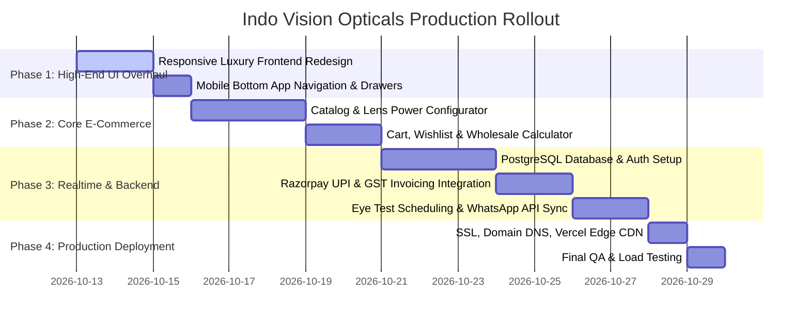

# Indo Vision Opticals — Production & Real-time Requirements Specification

**Document Version:** 1.0.0  
**Status:** Architecture & Requirements Alignment  
**Target Brand:** Indo Vision Opticals (Indo Opticals), Dilsukhnagar, Hyderabad  
**Prepared by:** Antigravity AI Engineering & Design Team  

---

## 1. Executive Summary & Objective

This document outlines the end-to-end technical, business, design, and infrastructure requirements to transition **Indo Vision Opticals** from a static frontend demo into a **production-grade, real-time, omnichannel e-commerce and B2B wholesale platform**.

Indo Vision Opticals operates both as:
1. **A Direct-to-Consumer (D2C) Optical Retailer:** Offering prescription spectacles, fashion sunglasses, blue-cut computer lenses, and computerized 14-step clinical eye examinations.
2. **A Business-to-Business (B2B) Optical Wholesaler:** Supplying optical shops, eye hospitals, and independent opticians across Telangana, Andhra Pradesh, and Pan-India with tiered volume discounts, optical lab glazing, and GST billing.

---

## 2. Brand Identity, Design & UX Standards

### 2.1 Aesthetic Directive (Luxury Optical Retail)
- **Design Language:** Ultra-clean, editorial luxury inspired by top-tier global and Indian optical leaders (*Vision Express, Gentle Monster, Lenskart Studio, Warby Parker*).
- **Core Color Palette:**
  - **Imperial Plum / Royal Magenta:** `#7A004C` / `#8A005D` (Dominant brand accent for CTAs, active states, and primary banners).
  - **Obsidian / Onyx Foundation:** `#110D10` / `#1A1618` (High-contrast editorial dark backgrounds and typography).
  - **Champagne Warm Gold:** `#C5A059` / `#D4AF37` (Accent seals, 5.0 rating stars, B2B VIP indicators).
  - **Optical Surface & Ivory:** `#F8F9FA` / `#FFFFFF` (Pure clinical cleanliness, ensuring frame colors and transparent lenses pop).
- **Typography:**
  - Primary UI & Body: **Outfit** or **Plus Jakarta Sans** (Geometric, crystalline legibility for clinical numbers, spherical/cylindrical powers, and product specs).
  - Editorial Headlines: **Bodoni Moda** or **Cinzel** (Curated high-fashion serif for luxury collections).
- **No Emojis Policy:** All visual iconography must use crisp, hairline SVG vector icons (cart, heart, search, phone, map pin, shield, checkmark) to eliminate any amateur or low-grade appearance.
- **Mobile-First Responsive Layout:**
  - Dedicated sticky mobile app header with hamburger drawer.
  - Persistent bottom mobile navigation bar (Home, Shop, 3D VTO, B2B, Bag).
  - Touch-optimized swipeable product and category rails (`-webkit-overflow-scrolling: touch`).

---

## 3. Core Functional Modules & Real-time Architecture

```
                                  +------------------------------------+
                                  |    Indo Vision Web / Mobile App    |
                                  +-----------------+------------------+
                                                    |
                   +--------------------------------+-------------------------------+
                   |                                |                               |
       +-----------v-----------+        +-----------v-----------+       +-----------v-----------+
       |   D2C Retail Store    |        |  B2B Wholesale Portal |       | Clinical Clinic Desk  |
       |  - 3D Virtual Try-On  |        |  - Tiered MOQ Engine  |       |  - Real-time Slots    |
       |  - Power Prescription |        |  - Lab Glazing Matrix |       |  - Auto Refractor Sync|
       |  - Razorpay / UPI     |        |  - GST B2B Invoicing  |       |  - WhatsApp Reminders |
       +-----------+-----------+        +-----------+-----------+       +-----------+-----------+
                   |                                |                               |
                   +--------------------------------+-------------------------------+
                                                    |
                                       +------------v------------+
                                       |  Real-Time Backend API  |
                                       |   (Node.js / Go / Supabase)
                                       +------------+------------+
                                                    |
                         +--------------------------+--------------------------+
                         |                          |                          |
              +----------v---------+     +----------v---------+     +----------v---------+
              | Realtime Database  |     | ERP / Inventory DB |     | Cloud Communications
              | (PostgreSQL / Redis|     | (Stock Sync @ Hyd) |     | (WhatsApp API, SMS)|
              +--------------------+     +--------------------+     +--------------------+
```

### 3.1 D2C Retail & Frame Configurator
1. **Prescription Upload & Manual Entry:**
   - Option to upload photo/PDF of doctor's prescription (OCR auto-extraction).
   - Structured prescription matrix: Right Eye (OD) & Left Eye (OS) for Sphere (`SPH`), Cylinder (`CYL`), Axis, Add Power, and Pupillary Distance (`PD`).
2. **Lens Type Customizer:**
   - Single Vision vs. Bifocal vs. Progressive vs. Zero-Power Blue Light Filter.
   - Lens Index Selector: Standard (1.50), Thin (1.56), Ultra-Thin (1.60), Featherweight High-Index (1.67 / 1.74).
   - Coatings: Anti-Reflective (ARC), Hydrophobic Blue-Block, Photochromic (Day/Night Transitions).
3. **Interactive 3D Virtual Try-On (VTO):**
   - Webcam live face-tracking using MediaPipe / WebAssembly face mesh.
   - Automatic PD calculation and realistic frame sizing.

### 3.2 B2B Wholesale Portal (Optical Retailers & Clinics)
1. **Tiered Quantity Engine:**
   - Dynamic real-time pricing based on order volume:
     - 10 – 49 pcs: Tier 1 (40% off retail)
     - 50 – 199 pcs: Tier 2 (55% off retail)
     - 200+ pcs: Tier 3 (68% off retail + complimentary custom laser engraving)
2. **Wholesale Verification:**
   - Registration flow with GSTIN verification (via GST Portal API) and Drug/Optical License verification.
   - Net 30/60 credit term application or instant UPI/NEFT settlement.
3. **Lab Glazing Job Cards:**
   - Ability for B2B stores to upload frame lots + lens power spreadsheets for central automated edging at Dilsukhnagar lab.

### 3.3 Clinical Eye Exam Appointment Desk
1. **Real-time Slot Booking:**
   - Syncs with store optometrist schedule (Monday – Sunday, 10:00 AM – 9:30 PM).
   - Prevents double bookings using Redis lock or database slot management.
   - Confirmation via automated WhatsApp notification and SMS with Google Maps location pin.

### 3.4 Real-time Inventory & Stock Tracking
1. Multi-location inventory support:
   - Dilsukhnagar Flagship Showroom (Retail stock).
   - Dilsukhnagar Central Warehouse (Wholesale cartons).
2. Low-stock thresholds with real-time "Only 2 frames left" warning triggers on product pages.

---

## 4. Production Tech Stack Recommendation

| Component | Recommended Technology | Alternatives | Rationale |
| :--- | :--- | :--- | :--- |
| **Frontend Framework** | **Next.js 14+ (React / TypeScript)** | Vite + React SPA | Server-Side Rendering (SSR) for SEO, lightning-fast Core Web Vitals, optimal image optimization. |
| **Styling & Design System** | **Tailwind CSS + Custom CSS Tokens** | Vanilla CSS + PostCSS | Exact control over bespoke luxury palette, zero runtime CSS overhead, full mobile responsiveness. |
| **Backend & Realtime API**| **Node.js (NestJS / Express) + Supabase** | Go (Gin) / FastAPI | Real-time WebSockets for cart/inventory sync, robust REST/GraphQL endpoints, built-in auth. |
| **Database** | **PostgreSQL (with Prisma or Supabase)** | MongoDB | Relational integrity for orders, customer prescriptions, tiered pricing, and GST tax calculations. |
| **Cache & Sessions** | **Redis** | Memcached | High-speed cart persistence, slot booking locks, rate limiting. |
| **Payment Gateway** | **Razorpay India / Cashfree** | Stripe India | Native support for UPI (GPay, PhonePe, Paytm), NetBanking, Credit Cards, EMI, and GST B2B invoices. |
| **Communication / Alerts**| **Twilio or Gupshup (WhatsApp Business API)** | MSG91 / Interakt | Instant order status updates, Eye Exam booking reminders, Wholesale quotation dispatch. |
| **Hosting & CDN** | **Vercel / AWS CloudFront + ECS** | Cloudflare Pages | Edge caching, sub-second load times across Hyderabad and Pan-India. |

---

## 5. Questionnaire: Information Needed from Store Owner

To tailor this production system with 100% precision, please provide the details below (you can answer any or all points):

### 🏢 Brand & Operations
1. **Official Registered Entity Name & GSTIN:**
   - What is the registered firm name for GST invoices (e.g., *Indo Opticals* or *Indo Vision Opticals LLP*)?
2. **Current ERP / Billing Software:**
   - Do you currently use any POS/inventory software in the Dilsukhnagar shop (e.g., *Tally Prime, Marg ERP, OptiDesk, RetailGraph, Excel*) that we should integrate with via API?
3. **Working Days & Special Timings:**
   - Is the showroom open 7 days a week from 10:00 AM to 9:30 PM, or are there different Sunday hours?

### 👓 Product Catalog & Brands
4. **Brand Portfolio:**
   - Which specific brands do you distribute at wholesale rates (e.g., in-house *Indo Vision* private label, *Ray-Ban, Carrera, Vogue, Fastrack, Velocity, Scott, Invu, Essilor, Crizal, Prime Lenses*)?
5. **Product Photography & SKUs:**
   - Do you have existing high-resolution studio photos of your frames on plain white backgrounds, or should we continue generating/providing curated photorealistic catalog assets?
   - Approximately how many active frame models/SKUs do you maintain in stock?

### 💰 Wholesale (B2B) Business Rules
6. **Minimum Order Quantity (MOQ):**
   - What is your standard minimum order quantity for wholesale buyers (e.g., minimum 10 frames, 25 frames, or 50 frames)?
7. **Payment & Credit Terms:**
   - Do you offer credit terms (e.g., 15 days / 30 days) for verified optical retailers, or is it strictly 100% advance / COD?
8. **Shipping & Freight:**
   - For wholesale dispatches outside Hyderabad (e.g., Warangal, Vijayawada, Vizag, Bengaluru), who bears the courier/transport charges (e.g., VRL, Navata, DTDC)?

### 🩺 Clinical Eye Exam Workflow
9. **Doctor / Optometrist Capacity:**
   - How many eye tests can you accommodate per hour? (Recommended: 30-minute slots = 2 appointments per hour).
10. **Home Eye Exam Service:**
    - Do you want to offer doorstep home eye testing across Hyderabad, or should appointments be strictly in-store at Dilsukhnagar?

### 💳 Payments & Logistics
11. **Preferred Payment Gateway:**
    - Do you already have an active merchant account with **Razorpay**, **Paytm for Business**, or **PhonePe Business**?
12. **Delivery Partner for Retail (D2C):**
    - Do you use **Shiprocket**, **Delhivery**, **Blue Dart**, or local Hyderabad delivery (Dunzo / Porter / Speed Post)?

---

## 6. Implementation Roadmap



---

*This document is stored at [requirements.md](file:///c:/Projects/IndoVisionOpticals/requirements.md) in your workspace root.*
